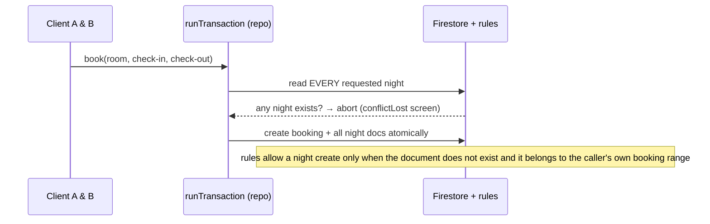

# حجوزات — Booking

**A hotel-room booking app: one Flutter codebase shipping Web + Android, with a server-enforced, race-tested, no-double-booking guarantee.** DEPI training project.

<p align="center">
  
</p>

## What it does

| | |
|---|---|
| 🔎 **Live search** | rooms stream by city, guest capacity, price sort, max-price filter |
| 🛡 **No double booking** | one atomic Firestore transaction + security rules — two clients racing for the same night get exactly one winner, even from a modified client |
| 📅 **Real availability** | one Firestore document per room per night (`rooms/{roomId}/nights/{epochDay}`) |
| 🌐 **Arabic RTL** | full RTL UI, localized validation + a typed error taxonomy (no raw Firebase strings in the UI) |
| 🔁 **Honest offline** | `offlinePending` means no night was taken; retry re-validates server-side |

**Try the app**: any reviewer can open «عن التطبيق» (info icon in the app bar, or the link on the login screen) — it explains the whole project in Arabic within one screen.

## Screens

| Search | Confirm |
|---|---|
|  |  |
| **Success** | **My bookings** |
|  |  |

| Login (entry + About link) | About (project identity, pre-login) |
|---|---|
|  |  |

## The guarantee — how two racing bookings end with one winner



The rules are the second defense line: the same invariant enforced server-side, so exactly one transaction commits. The full engine design lives in [docs/designs/booking_search_conflict_free_engine.md](docs/designs/booking_search_conflict_free_engine.md).

## Run it

```bash
flutter pub get

# Web (dev flavor: dev_-prefixed collections)
flutter run -d chrome -t lib/main_development.dart

# Android
flutter run -t lib/main_development.dart
```

Demo login for the dev environment: **demo@booking.dev / Demo1234!**
Firebase project: `sahety-ba784` (this booking app registers its own Android `com.example.booking` + Web app; pre-existing registrations in the shared project are never touched).

## Tests

```bash
flutter analyze && flutter test          # 46 unit + widget + fake-backed repo tests

# Rules scenarios (second defense line) — Java 21+ for the emulator
cd tool/rules && firebase emulators:exec --only firestore "npm test"

# The race gate: two concurrent transactions, one winner (Android emulator)
FIRESTORE_EMULATOR_HOST=localhost:8080 SEED_PREFIX=dev_ node tool/seed/seed.mjs
flutter test integration_test/booking_race_test.dart -d <device>
```

The room catalog is client-read-only by the rules — seeding goes through the Admin SDK (or an emulator): `SEED_PREFIX=dev_ node tool/seed/seed.mjs`.

## Structure

```
lib/
├── core/          di, routing, theming, StayDate, FirestorePaths, error taxonomy
└── features/
    ├── auth/          login + sign-up (terminal-action cubit)
    ├── search/        home form + live results (stream cubit)
    ├── room_details/  one-shot load + night multi-get availability check
    └── booking/       transaction engine + confirm/conflict/my-bookings
```

Two cubit kinds, never mixed: **stream cubits** (`connecting/live/empty/failure`) for Firestore streams, **terminal-action cubits** (`idle/submitting/…/failure`) for auth/booking/cancel.

---

<p align="center">مشروع تدريبي — DEPI · Flutter · Firebase</p>
